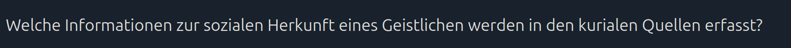
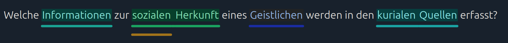
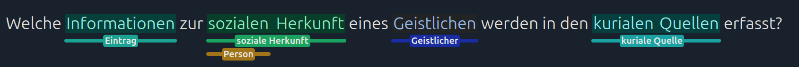

# Wie wir Annotationen vorschlagen

Annotationen werden in zwei Schritten vorgeschlagen. Zunächst analysiert ein maschinelles Sprachmodell den Satzbau und ermittelt mögliche Textstellen für Annotationen. Anschließend vergleicht das System jeden Kandidaten anhand seiner Formulierung und seines Kontexts mit vorhandenen Glossarbegriffen.

Als Beispiel verwenden wir diese Frage:

## Part-of-Speech-Tags

Zunächst analysieren wir die Wörter in der Frage. Ein **Part-of-Speech-Tag (POS-Tag)** beschreibt die grammatische Funktion eines Wortes, zum Beispiel ob es ein Substantiv, Verb oder Adjektiv ist. Der [spaCy-Leitfaden zum POS-Tagging](https://spacy.io/usage/linguistic-features#pos-tagging) erklärt das genauer.

Für deutsche Fragen verwendet die App derzeit das deutsche Sprachmodell von spaCy.

Das Sprachmodell nutzt diese Tags und den Satzbau, um [Nominalphrasen](https://spacy.io/usage/linguistic-features#noun-chunks) und [benannte Entitäten](https://spacy.io/usage/linguistic-features#named-entities) zu finden. Diese verwenden wir als Kandidaten für mögliche Annotationen. In der Beispielfrage hat das Modell unter anderem die Textstellen **Informationen**, **sozialen Herkunft**, **Geistlichen**, **kurialen Quellen** und **soziale** extrahiert.

## Abgleich mit Glossarbegriffen

Anschließend wird jeder Kandidat mit dem Projektglossar und mit Textstellen verglichen, die bereits mit Glossarbegriffen annotiert wurden.

Zuerst sucht das System nach derselben Formulierung. Dabei berücksichtigt es auch Unterschiede bei Groß- und Kleinschreibung sowie zusätzliche Leerzeichen. Findet es keine genaue Übereinstimmung, sucht es nach einer ähnlichen Schreibweise anhand einer hohen [Jaro-Winkler-Ähnlichkeit](https://en.wikipedia.org/wiki/Jaro%E2%80%93Winkler_distance). Gibt es auch dabei keinen Treffer, vergleicht das System den umgebenden Text des Kandidaten mit Beispielen aus Annotationen in anderen Fragen.

Wird kein passender Glossarbegriff gefunden, schlägt das System die Kandidatenphrase selbst als neuen Glossarbegriff vor. Dabei werden Leerzeichen und Satzzeichen am Anfang und Ende entfernt.

Die Kandidaten **Geistlichen**, **sozialen Herkunft** und **kurialen Quellen** wurden hier aufgrund hoher lexikalischer Ähnlichkeit ihren jeweiligen Glossarbegriffen zugeordnet. Für die beiden anderen Kandidaten gab es keinen passenden lexikalischen Treffer. Daher schlug das System den ähnlichsten Begriff anhand des Kontexts vor. Bei **Informationen** könnte das passen; der Vorschlag für **soziale** ist wahrscheinlich ein Fehlvorschlag. Die bearbeitende Person muss jeden Vorschlag bestätigen, bevor er gespeichert wird. Ein Fehlvorschlag wird also nicht automatisch als Annotation oder Glossarbegriff übernommen.

## Warum kann ein Vorschlag seltsam wirken?

Das Sprachmodell trifft Vorhersagen, versteht eine Frage aber nicht so wie ein Mensch. Es kann eine unpassende Textgrenze wählen, besonders bei langen oder historischen Formulierungen. Auch die POS-Tags können falsch sein. Dadurch kann ein Kandidat zu kurz oder zu weit gefasst sein.

Auch der Abgleich kann zu unerwarteten Begriffen führen. Zwei Formulierungen können sich ähneln, ohne dass sie dasselbe bedeuten. Ebenso kann der umgebende Text ähnlich sein, obwohl die Begriffe unterschiedliche Konzepte bezeichnen. Wird keine Übereinstimmung gefunden, schlägt das System die Phrase nach einer einfachen Bereinigung als neuen Glossarbegriff vor. Dabei kann es sich weiterhin um eine flektierte Wortform oder einen unvollständigen Ausdruck handeln.

Deshalb sollten Vorschläge vor dem Speichern geprüft werden. Sie sollen die Annotation erleichtern; die endgültige Entscheidung liegt bei der Person, die die Frage bearbeitet.
