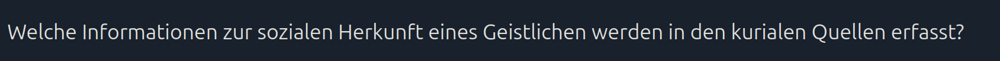
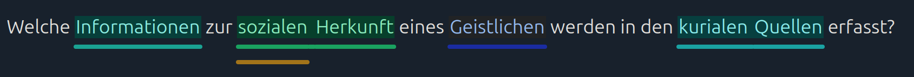
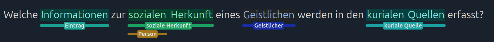

# How we propose annotations

Annotation proposals are generated in two stages. First, a machine learning model analyzes the sentence structure and extracts possible annotation spans. Then, each candidate is compared with existing glossary terms by wording and by the context around it.

We will use this question as a working example:

## Part-of-speech tagging

First, we analyze the words in the question. A **part-of-speech (POS) tag** describes what a word is doing grammatically, for example whether it is a noun, verb, or adjective. The [spaCy guide to POS tagging](https://spacy.io/usage/linguistic-features#pos-tagging) explains this in more detail. For German questions, the app currently uses spaCy's German language model.

The language model uses these tags and the sentence structure to find [noun phrases](https://spacy.io/usage/linguistic-features#noun-chunks) and [named entities](https://spacy.io/usage/linguistic-features#named-entities), which we use as candidates for possible annotations. For the example question, the model extracted phrases including **Informationen**, **sozialen Herkunft**, **Geistlichen**, **kurialen Quellen**, and **soziale**.

## Matching phrases to glossary terms

Next, each candidate phrase is compared with the project glossary and with phrases that have already been annotated with glossary terms.

The matching process first looks for the same wording, allowing for differences such as capitalization or extra spaces. If it does not find an exact match, it looks for a close spelling match based on a high [Jaro-Winkler-Similarity](https://en.wikipedia.org/wiki/Jaro%E2%80%93Winkler_distance). When neither gives a match, the system compares the words around the candidate with examples from annotations in other questions.

If no suitable match is found, the candidate phrase itself is suggested as a new glossary term with light normalization (Singularization, remove punctation, whitespaces, ...).

Here, the candidates **Geistlichen**, **sozialen Herkunft**, and **kurialen Quellen** were matched with their respective glossary terms based on high lexical similarity. For the other two candidates, no close lexical match was found, so the system suggested the next-best match based on context. This may make sense for **Informationen**, but the suggestion for **soziale** is probably a false positive. A reviewer must approve each proposal before it is saved, so a false positive is not automatically added as an annotation or glossary term.

## Why can a suggestion look strange?

The language model makes predictions; it does not understand the question exactly as a human reader does. It can choose an awkward phrase boundary, especially with long or historical wording. POS tags can also be wrong, which may lead to a fragment that is too short or too broad.

Matching can also produce an unexpected term. Two phrases may look similar without meaning the same thing. Their surrounding contexts may be similar even when the concepts differ. Finally, an unmatched phrase is offered as a new glossary term after only basic cleanup, so it can still be an inflected word or an incomplete phrase.
